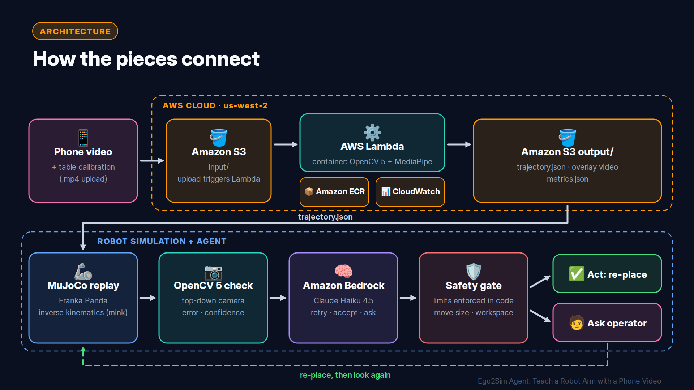
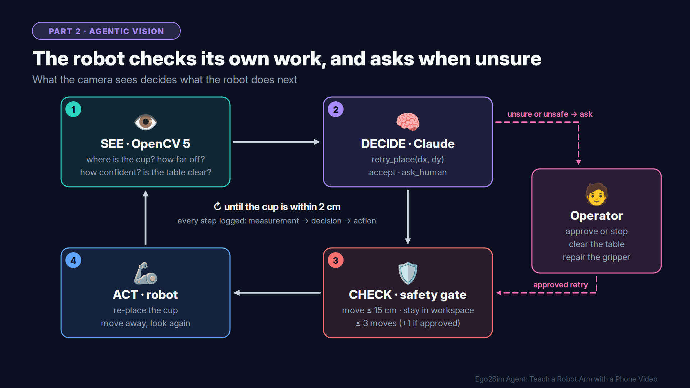

# Ego2Sim Agent: Teach a Robot Arm with a Phone Video

Film yourself moving a cup with a phone. Ego2Sim tracks the hand and cup, maps them to the tabletop with OpenCV 5, and replays the task on a Franka Panda in MuJoCo. No teleop needed. The robot then checks its own placement with OpenCV, and a Claude agent on Amazon Bedrock decides whether to retry, accept, or ask a human.

- **Video (under 5 min):** https://www.youtube.com/watch?v=nowQ7quGa8c
- **Technical report:** [REPORT.md](REPORT.md)
- **Live demo:** a live screen-share demonstration is available on request.
- **Author:** Venkat Ram (solo)

Built for the OpenCV AI Competition 2026 (powered by AWS), including the Agentic Vision path.

## What it does

**Part 1, Ego2Sim (phone video to robot)**

1. A phone video shows a hand moving a red cup on a table.
2. The video and a calibration file are uploaded to Amazon S3.
3. An AWS Lambda container runs the OpenCV 5 pipeline: cup segmentation (HSV, contours, moments), a homography from four table corners (`cv2.findHomography`, `cv2.perspectiveTransform`), MediaPipe hand landmarks, gap filling, and grasp/release detection. It writes `trajectory.json` and an overlay video back to S3.
4. On the local machine, the trajectory is mapped into the robot workspace, solved with inverse kinematics (mink), and replayed on a Franka Panda in MuJoCo.

**Part 2, Agentic vision (the robot checks its own work)**

5. After placing the cup, the arm moves aside and a top-down camera image is analyzed with OpenCV 5: four markers give a homography, the cup position is measured in robot meters, and unexpected objects in the workspace are detected.
6. Claude (Haiku 4.5 on Amazon Bedrock, Converse API with tool use) receives the measurement as numbers and must call one tool: `retry_place`, `accept`, or `ask_human`.
7. A safety gate in code checks every action before it runs. The loop repeats until the cup is on target, a human stops it, or the move budget is used up.

The OpenCV measurement changes the next action in every loop, and every step is logged to `trace.jsonl`.

## Architecture





| Component | Role |
|---|---|
| OpenCV 5 (`opencv-contrib-python==5.0.0.93`) | Cup tracking, homography, overlays, placement check, obstruction detection |
| Amazon S3 | Input video + calibration, output trajectory + overlay (private bucket) |
| AWS Lambda (container image) | Runs the OpenCV 5 vision pipeline, triggered by S3 upload |
| Amazon ECR | Stores the container image |
| Amazon CloudWatch | One structured `ego2sim_run` log line per run |
| Amazon Bedrock | Claude Haiku 4.5 decides retry / accept / ask human |
| MuJoCo + mink (local) | Franka Panda replay and inverse kinematics |

## Repository layout

```
ego2sim/vision/   OpenCV 5 pipeline: homography, cup and hand tracking, events, overlay, Lambda handler
ego2sim/sim/      Map trajectory to the robot, inverse kinematics, MuJoCo replay
ego2sim/agent/    Check scene, OpenCV verification, arm motion, loop, safety gate, Bedrock agent
scripts/          One-command entry points (see below)
aws/              Dockerfile for the Lambda container
tests/            pytest tests
assets/           Diagrams and evaluation evidence (assets/evidence/)
```

## Setup

Requirements: Python 3.12, [uv](https://docs.astral.sh/uv/) (or pip), macOS or Linux. Dependencies are pinned in `requirements.txt` (local) and `requirements-cloud.txt` (Lambda image).

```bash
uv venv --python 3.12 .venv
source .venv/bin/activate
uv pip install -r requirements.txt
python -c "import cv2; print(cv2.__version__)"   # expect 5.0.0
```

Install only `opencv-contrib-python`. Having `opencv-python` installed as well breaks the import.

Third-party assets (not in this repo):

```bash
git clone --depth 1 https://github.com/google-deepmind/mujoco_menagerie third_party/mujoco_menagerie
mkdir -p models
curl -L -o models/hand_landmarker.task \
  https://storage.googleapis.com/mediapipe-models/hand_landmarker/hand_landmarker/float16/latest/hand_landmarker.task
```

## Run locally

Input: a phone video `data/raw/<take>.mov` and a calibration file `data/calibration/<take>.json` (four table corners in pixels, the matching table coordinates, and the cup's HSV ranges).

```bash
python scripts/prepare_video.py --take take01     # normalize phone video to 8-bit H.264 .mp4
python scripts/run_pipeline.py --take take01      # vision -> trajectory -> MuJoCo replay -> 3-panel video
```

Outputs go to `outputs/take01/` (`trajectory.json`, `overlay.mp4`, `composite_wide.mp4`, `sim_metrics.json`).

The agent loop:

```bash
python scripts/run_loop.py --seed 3 --mode baseline --video                    # fixed rule, no LLM, no AWS needed
python scripts/run_loop.py --seed 3 --mode llm --scenario obstructed           # Claude decides; answer y/n when asked
python scripts/run_loop.py --seeds 0-9 --modes none,baseline,llm --scenarios all --human auto-yes   # full evaluation
```

Scenarios: `clean`, `occluded`, `obstructed`, `slip`, `slip_repair`. Each trial writes `trace.jsonl`, `verify.json` and check images to `outputs/take01_loop/<scenario>/<mode>/seed_XX/`.

## Deploy on AWS

Prerequisites: an AWS account, the AWS CLI configured with an IAM user (not root), and Docker. Never commit credentials; keys stay in `~/.aws/credentials`.

Create a `.env` file (gitignored):

```
BUCKET=<your-bucket>
AWS_REGION=us-west-2
ECR_IMAGE=<account-id>.dkr.ecr.us-west-2.amazonaws.com/ego2sim-vision:v1
BEDROCK_MODEL_ID=us.anthropic.claude-haiku-4-5-20251001-v1:0
```

1. **S3 bucket**, private:
   ```bash
   aws s3 mb s3://$BUCKET --region us-west-2
   aws s3api put-public-access-block --bucket $BUCKET \
     --public-access-block-configuration BlockPublicAcls=true,IgnorePublicAcls=true,BlockPublicPolicy=true,RestrictPublicBuckets=true
   ```
2. **Container image** (create the ECR repository `ego2sim-vision` first):
   ```bash
   docker build --platform linux/amd64 --provenance=false -t ego2sim-vision -f aws/Dockerfile .
   aws ecr get-login-password | docker login --username AWS --password-stdin ${ECR_IMAGE%%/*}
   docker tag ego2sim-vision $ECR_IMAGE
   docker push $ECR_IMAGE
   ```
3. **Lambda function** from that image: architecture x86_64, memory 3008 MB, timeout 900 s, ephemeral storage 2048 MB. Its role needs `AWSLambdaBasicExecutionRole` plus `s3:GetObject` on `input/*` and `s3:PutObject` on `output/*` of the bucket only.
4. **S3 trigger** on the function: event PUT, prefix `input/`, suffix `.mp4`.
5. **Bedrock:** enable Claude Haiku 4.5 in the same region. The first use of an Anthropic model requires a short use-case form in the Bedrock console.

Run end to end (upload, trigger, wait, download, local replay):

```bash
python scripts/run_cloud.py --take take01
```

Results land in `outputs/take01_cloud/`. Logs are in CloudWatch under `/aws/lambda/<function-name>`.

## Tests

```bash
pytest
```

Covers the homography round-trip, the `trajectory.json` format, and agent tool parsing with a mocked Bedrock reply. The tests need no AWS account.

## Results

Vision, `take01` (454 frames):

| | Local (Mac) | Cloud (Lambda) |
|---|---|---|
| Cup tracked | 454 / 454 | 454 / 454 |
| Hand detected (rest gap-filled) | 75.1 % | 76.9 % |
| Grasp frames | 165–227 | 164–223 |
| Release frame | 301 | 304 |
| Processing time | 10.6 s | 26.6 s |

End to end in the cloud (upload to results) takes about 53 s.

Agent, 10 seeds per scenario, simulated operator answering "yes":

| Scenario | Fixed rule (no LLM): handled · unsafe moves | Claude: handled · unsafe moves | Claude asks human |
|---|---|---|---|
| Small miss | 10/10 · 0 | 10/10 · 0 | 0 |
| Cup partly hidden | 0/10 · 30 | 10/10 · 0 | 10 |
| Object in the way | 0/10 · 10 | 10/10 · 0 | 10 |
| Gripper slipping | 0/10 · 0 | 10/10 · 0 | 20 |
| Slipping, then repaired | 0/10 · 0 | 10/10 · 0 | 17 |

"Handled" means the right behaviour for that scenario, for example asking a human before any move when the scene cannot be trusted. Raw data and a sample agent trace: [assets/evidence/](assets/evidence/). About 1.3 s and well under one US cent per decision.

A hand-written rule could be extended to cover each of these cases. The point is not that an LLM is required. It is that the agent follows plain-language safety rules across different situations, explains every decision, and escalates to a human, while the code-level safety gate has the final say.

## Safety limits (enforced in code)

- A correction is clamped to 15 cm, and destinations outside the workspace are rejected.
- The robot may make 3 moves on its own; a human may approve 1 more.
- Any Bedrock error or malformed reply becomes `ask_human`.
- A move made while confidence is low or the workspace is not clear is counted as unsafe.

## Current scope

- Everything after the phone video runs in simulation. Placement errors are injected on purpose, and the cup is carried kinematically (no grasp physics).
- The human operator is simulated in batch runs.

## Responsible use

The video shows only the author's own hand, with no faces. The S3 bucket is private, the Lambda role can reach only its own input and output prefixes, and no credentials are stored in the repository. The agent cannot act outside the code-level limits, and it hands control to a human when the scene is uncertain.

## Credits

- [OpenCV 5](https://opencv.org/) (OpenCV.org)
- Amazon Web Services: Amazon S3, AWS Lambda, Amazon ECR, Amazon CloudWatch, Amazon Bedrock
- [Claude Haiku 4.5](https://www.anthropic.com/) (Anthropic), via Amazon Bedrock
- [MuJoCo](https://mujoco.org/) and [MuJoCo Menagerie](https://github.com/google-deepmind/mujoco_menagerie) (Google DeepMind); Franka Emika Panda model, robot by Franka Robotics
- [MediaPipe Hand Landmarker](https://ai.google.dev/edge/mediapipe/solutions/vision/hand_landmarker) (Google)
- [mink](https://github.com/kevinzakka/mink) (Kevin Zakka) and [DAQP](https://github.com/darnstrom/daqp) (Daniel Arnström et al.)
- NumPy, FFmpeg, imageio-ffmpeg, mediapy, boto3, Docker
- Typefaces in the video: Inter (Rasmus Andersson), Noto Color Emoji (Google)

Open-source tools are used under their respective licenses. All trademarks belong to their owners.

## References

Motivated by the growing "learn from human video, not teleop" direction in robotics, including work like EgoVerse.

- Punamiya, R., Kareer, S., Liu, Z., et al. *EgoVerse: An Egocentric Human Dataset for Robot Learning from Around the World.* arXiv:2604.07607. https://arxiv.org/abs/2604.07607
